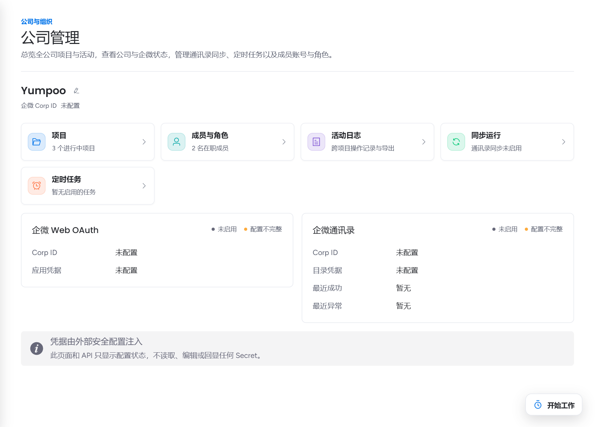
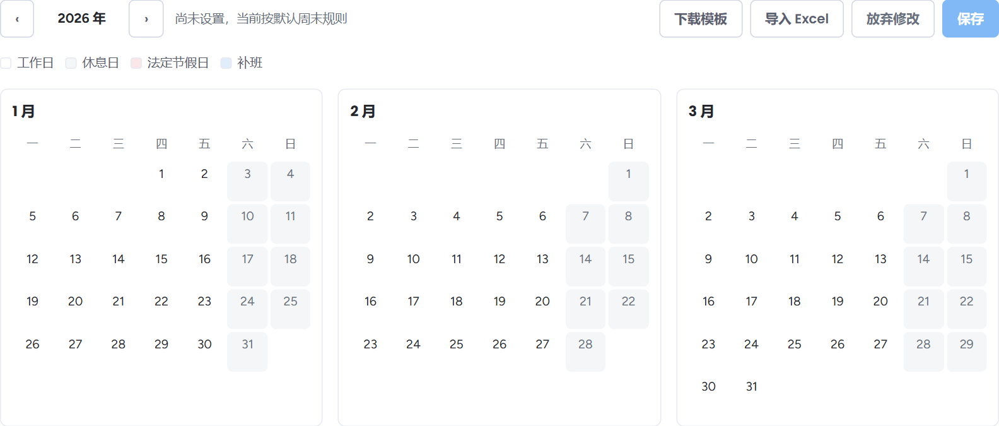
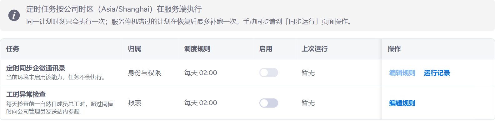

公司管理员在模块栏多了「团队」和「公司管理」两个入口。第一次使用时，按下面的顺序检查一遍，就能让成员的登录、工时统计和提醒都按公司的规则运作。

::: steps
1. **看公司概览**。进入「公司管理 → 概览」，确认企业微信登录和通讯录同步已经配置，最近一次同步成功。公司名称可以在这里修改。

   

2. **整理成员与角色**。在「成员与角色」查看全部成员、在职状态和角色。需要更多人一起管理时，请平台管理员把对方设为公司管理员。离职成员会在通讯录同步时自动停用账号。
3. **维护工作日历**。在「工作日历」按年查看工作日、休息日、法定节假日和补班。可以下载模板、点「导入 Excel」批量导入节假日安排，检查无误后点击「保存」才会生效。工作日的「标准工时（小时）」决定成员每天应记录的工时，休息日和法定节假日的工时计为加班。同一页还可以设置工时异常提醒的阈值。

   

4. **启用定时任务**。在「定时任务」里有「定时同步企微通讯录」和「工时异常检查」两项，**默认停用**。按需设置执行时间并启用；任务按公司时区在服务端执行。

   

5. **打开团队视图**。模块栏「团队」里有「成员工时」「加班统计」和「成员当前任务」三页，按周、月或季查看成员工时，可以导出 Excel；要把原协作平台的历史工时带进来，在「成员工时」右上角点「迁入工时」，详见 [团队视图](../guide/team.md#迁入工时)。
:::

::: info 管理员也能看到所有项目
「公司管理 → 项目」列出全公司的项目，包括你没有参与的项目，便于查看负责人和状态。日常协作仍然需要被加入项目。
:::

本文截图使用演示数据，具体名称与数值以你的界面为准。

## 相关页面

- [公司管理](../guide/company.md)
- [团队视图](../guide/team.md)
- [角色与权限](../intro/roles.md)
