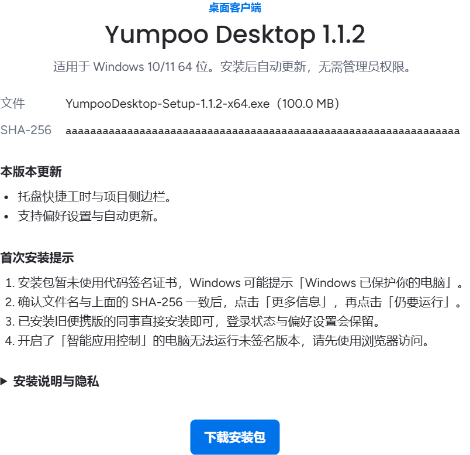
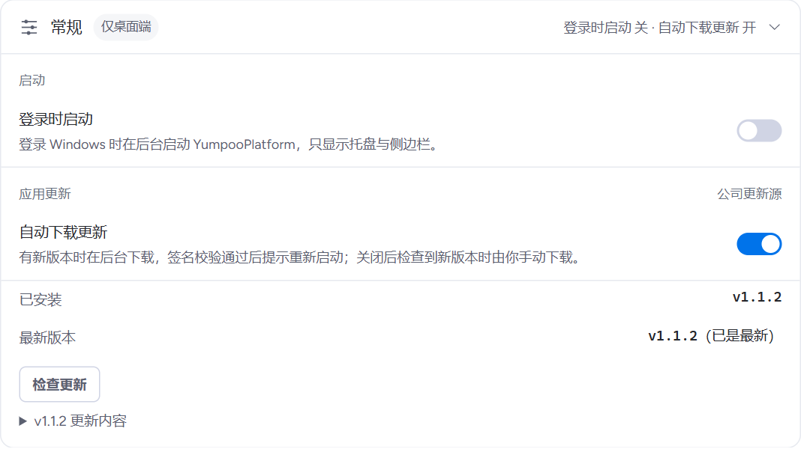

<!-- 与 deployment/windows/desktop-client-install-and-privacy.md 保持同步 -->

Yumpoo Desktop 是 Windows 客户端。它加载的就是公司部署地址上的 Web 应用，另外提供悬浮计时、托盘快捷工时小窗、系统通知和自动更新。客户端需要连接服务器，不能离线使用。

本文截图使用演示数据，具体名称与数值以你的界面为准。

## 下载与安装

::: steps
1. 在浏览器中打开 [下载页](/download)，下载安装包。页面上列出了文件名和 SHA-256，可以用来核对下载的文件。

   

2. 双击安装包。安装器依次显示「安装须知与隐私说明」（点「我同意」继续）、选择安装位置、附加选项和安装进度。
3. 安装只为当前 Windows 用户进行，**不需要管理员权限**。默认安装到 `%LOCALAPPDATA%\Programs\YumpooDesktop`，可以改到别的目录，也可以选择是否创建桌面快捷方式。
4. 完成页可以勾选「运行 Yumpoo Desktop」直接启动。
:::

::: warning 首次运行的系统提示
安装包暂未使用代码签名证书，Windows 可能提示「Windows 已保护你的电脑」。确认文件名和 SHA-256 与下载页一致后，点击「更多信息」，再点击「仍要运行」。开启了「智能应用控制」的电脑无法运行未签名版本，请先使用浏览器访问。
:::

已经装过旧便携版的同事直接安装即可，登录状态和偏好设置会保留。

## 登录

客户端会在**系统默认浏览器**中打开企业微信官方扫码页。扫码完成后，浏览器会把你带回客户端。

- 「7 天内免登录」默认勾选。勾选时，登录凭据经 Windows 数据保护（DPAPI）加密保存在本机；不勾选则每次启动都要重新登录。
- 共用电脑请取消勾选，离开前在客户端里退出登录。

## 自动更新

客户端在后台检查和下载新版本，核对公司签发的更新授权（签名、版本、文件大小和摘要）后，在你退出客户端时安装。任何一项核对不通过，下载的文件都会被删除，绝不安装；客户端也不会降级到更低的版本。

不想自动下载时，在「偏好设置 → 常规」关闭「自动下载更新」，之后检查到新版本时由你手动下载。详见 [桌面客户端](../guide/desktop.md#自动更新)。

## 隐私说明

- 网页、接口和自动更新只连接公司服务器。登录时在系统浏览器中打开企业微信官方授权页。不含第三方统计或广告。
- 唯一的例外：内置拼写检查会从 Google 下载服务器下载一次英文词典文件，请求不带账号信息或输入内容。
- 日志已脱敏，崩溃转储只保存在本机。「诊断与修复」里导出的诊断包可能含内存片段，请只发给管理员。
- 默认不开机自启，可以在偏好设置中开启「登录时启动」。

## 卸载

在 Windows「设置 → 应用」中卸载 Yumpoo Desktop。卸载会删除程序、登录凭据、缓存和日志，只保留计时器、提醒与桌面偏好，重新安装后这些设置不变。
