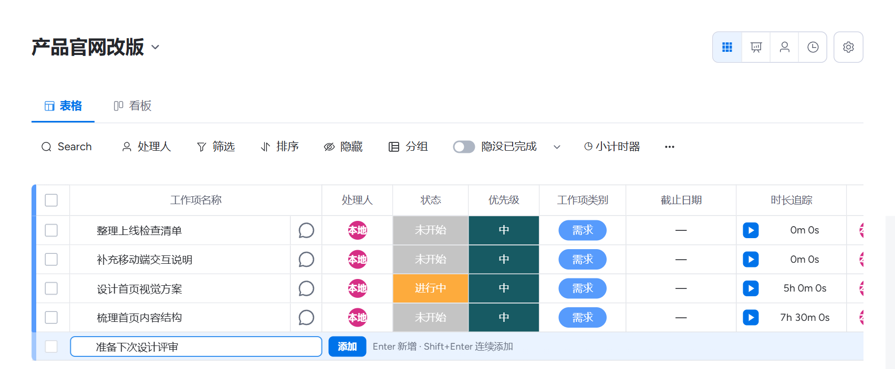
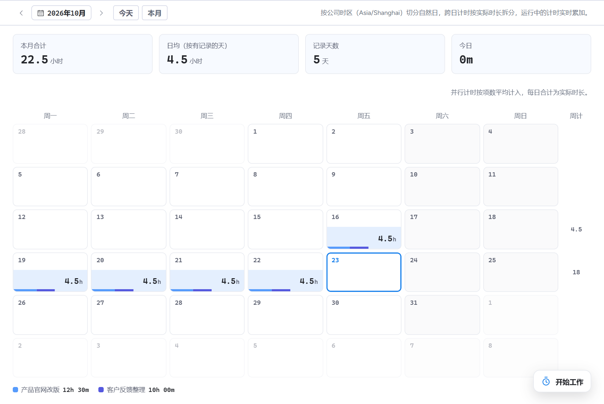
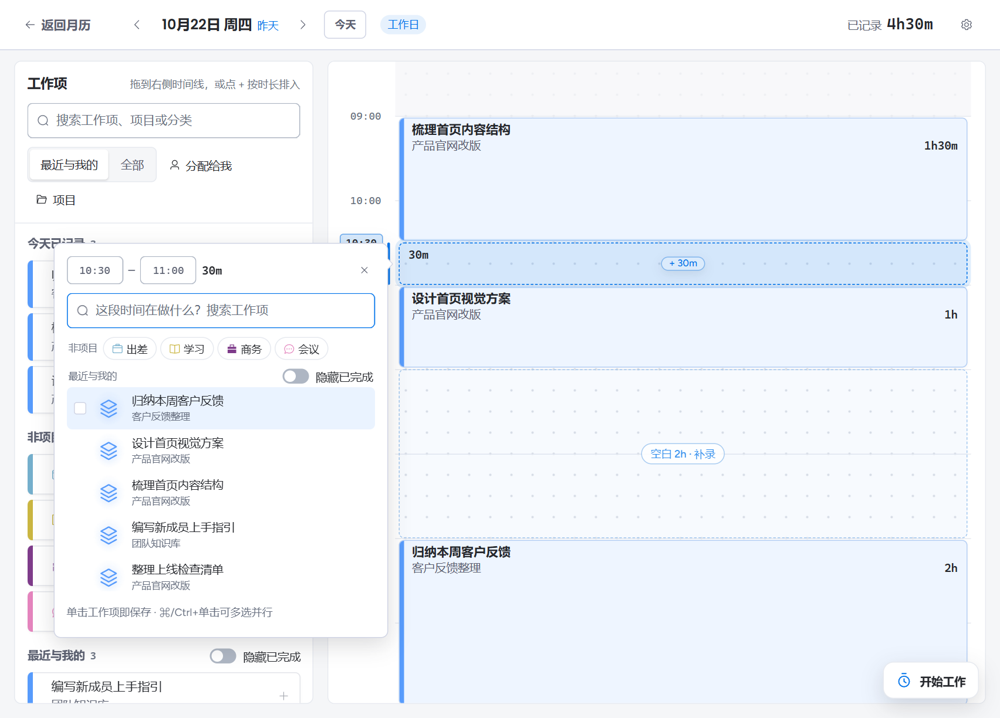

这篇按第一天上班的顺序，带你走完登录、找项目、添加工作项、计时和查看工时。每一步都只用到最常用的入口，更多用法见 [使用指南](../guide/navigation.md)。

本文截图使用演示数据，具体名称与数值以你的界面为准。

## 七步走完第一天

::: steps
1. **扫码登录**。打开公司部署地址，点击「使用企业微信扫码登录」，用企业微信扫码确认；桌面客户端里这个按钮是「在系统浏览器中登录」。「7 天内免登录」默认勾选，7 天内再打开不用重新扫码；在共用电脑上请取消勾选。
2. **认识首页**。首页上方是快捷入口；左边「我的工作项」列出分配给你、进行中和待开始的工作项，逾期会标红；右边的工时日历显示本月每天记录了多少工时。第一次登录时会弹出欢迎导览，跟着走一遍大约 1 分钟。
3. **打开一个项目**。点击首页的项目卡片，或者在左侧模块栏进入「工作台」，从项目列表里选一个。你只能看到自己参与的项目。

   

4. **添加工作项**。在表格底部的「添加工作项」里输入名称，按 `Enter` 创建；按 `Shift+Enter` 创建后会留在输入框里继续添加下一条。
5. **开始计时**。点击工作项那一行的计时单元格开始计时，再点一次停止；也可以点页面右下角的「开始工作」，搜索工作项后开始。可以同时给多项计时。

   

6. **查看和补录工时**。在「工作台 → 我的工时」查看本月每天的合计。忘了计时？点击某一天打开「我的一天」，在时间线空白处拖出一段时间补录，最短 15 分钟。

   

   

7. **处理通知**。有人在讨论里 @你、回复你或把工作项指派给你时，顶栏的收件箱会显示未读数。点开通知直接跳到相关工作项。
:::

::: tip 随时重看导览
每个主要页面都有界面导览。点击右上角的「查看本页引导」按钮，可以重新看一遍当前页面的讲解。
:::

## 接下来读什么

- 想把表格用顺手：[工作项表格与看板](../guide/work-items.md)
- 想弄清工时怎么算：[计时与工时](../guide/time-tracking.md)
- 想在 Windows 上用客户端：[安装桌面客户端](desktop.md)
- 遇到问题：[常见问题](../guide/faq.md)
